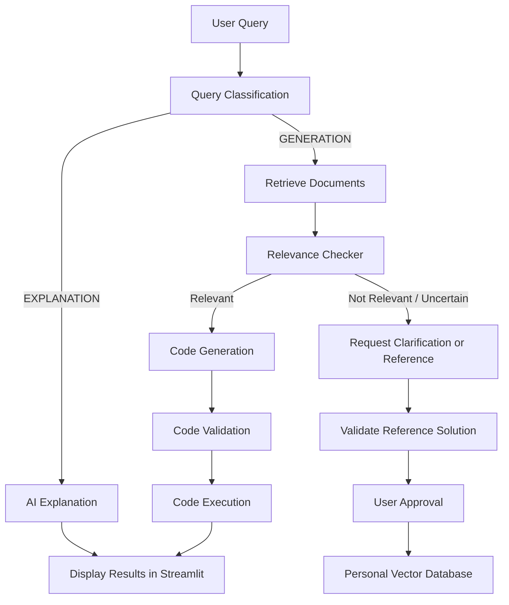

<<<<<<< HEAD
# CodePilot: Code Assistant and Voice Data Analyst

One FastAPI web application combines the original CodePilot programming
assistant with voice-based dataset analysis.

- **Accounts and workspace selection:** Create an account, sign in, then choose
  Data Analysis or Code Assistant. Passwords are stored as salted PBKDF2 hashes
  in a local SQLite account database. The Code Assistant has separate
  Explanation and Generation modes.
- **Code assistant:** Generate code, debug, or explain programming topics using
  HumanEval examples, saved personal solutions, relevance evaluation, Tavily web
  research, and linked references. Generated answers include a representative
  expected-output example labeled as illustrative (not executed). The
  full-width conversation formats generated solutions with a title, a numbered
  "How It Works" summary, and a syntax-highlighted code panel with line numbers
  and copy control. Explanations use natural Markdown with white text and blue
  headings and links, rather than fixed summary cards. Python comments are
  highlighted separately.
  It also includes pipeline traces, retrieved-example inspection, validation,
  explicitly approved local execution, and opt-in saving of validated Python
  reference solutions.
- **Data analyst:** Upload CSV files and ask questions by typing, recording
  speech in the browser, or uploading an audio file. Faster-Whisper transcribes
  speech, an LLM generates a read-only SQLite query, and the UI presents the
  results and an explanation.

## Setup

Use Python 3.10 or newer:

```powershell
py -m pip install -r requirements.txt
```

Add an LLM API key to `.env`:

```text
OPENROUTER_API_KEY=your-openrouter-key
```

Or use OpenAI directly:

```text
OPENAI_API_KEY=your-openai-key
```

Configure a persistent session-signing key in `.env`:

```text
CODEPILOT_SESSION_SECRET=paste-a-random-secret-here
```

Generate a session secret with:

```powershell
py -c "import secrets; print(secrets.token_urlsafe(32))"
```

If no session secret is configured, the app creates a temporary one at startup,
so users will need to sign in again after a restart. Set
`CODEPILOT_COOKIE_SECURE=true` when serving the app over HTTPS. Keep the
session secret private; do not commit it.

The first voice request downloads the configured Faster-Whisper model
(`base` by default). Set `WHISPER_MODEL_SIZE`, `WHISPER_DEVICE`, and
`WHISPER_COMPUTE_TYPE` in `.env` to change its model/runtime settings.

## Start the API

Run from this directory:

```powershell
py -m uvicorn Full_Project:app --reload
```

The Faster-Whisper version in this project uses the `metadata_errors` argument
of PyAV's `av.open()`. The requirements file pins PyAV below version 19 because
PyAV 19 removed that argument.

Interactive API documentation is available at `http://127.0.0.1:8000/docs`.
Uploaded CSV databases are stored locally under `data/analysis_datasets/`.
Uploads are limited to 25 MB, 100,000 rows, and 200 columns.
The browser app provides account registration and sign-in, then a workspace
chooser for the **Data Analyst** and **Code Assistant**. Account records are
stored in `data/auth_users.sqlite3`, which is ignored by Git. Usernames can be
any printable characters (1–32 characters), and passwords need only be at
least 6 characters. All assistant and dataset API endpoints require an
authenticated session.

## Endpoints

- `GET /health` — health check.
- `POST /auth/register`, `POST /auth/login`, `POST /auth/logout`, and
  `GET /auth/session` — create accounts and manage authenticated sessions.
- `POST /assistant/chat` — code generation, programming explanations, and
  Tavily references. Send `{"query":"Build a FastAPI endpoint ...","mode":"GENERATION"}`.
  Set `mode` to `EXPLANATION` for an explanation; omit it to use automatic
  intent classification.
- `POST /assistant/validate` — validate Python after confirming that you trust
  the submitted code; basic validation executes it.
- `POST /assistant/execute` — run Python code after explicit approval.
- `POST /assistant/reference-solutions` — validate and save an approved Python
  reference solution to personal retrieval memory.
- `POST /datasets/upload` — upload a CSV as multipart field `file`; returns a
  `dataset_id` and detected columns.
- `GET /datasets/{dataset_id}/schema` — inspect schema, row count, and sample.
- `POST /audio/transcribe` — upload audio as multipart field `file` and return
  its transcript without running analysis.
- `POST /datasets/{dataset_id}/sql/generate` — generate and validate SQL from a
  JSON body such as `{"question":"Which month had the most sales?"}`.
- `POST /datasets/{dataset_id}/sql/execute` — execute a read-only SQL query
  supplied as `{"sql":"SELECT ... FROM uploaded_data"}`.
- `POST /datasets/{dataset_id}/analyze` — run the complete text-question
  pipeline.
- `POST /datasets/{dataset_id}/analyze/audio` — upload an audio file in the
  multipart field `file` and run transcription, SQL generation, execution, and
  explanation in one request.

Example upload:

```powershell
curl.exe -F "file=@sales.csv" http://127.0.0.1:8000/datasets/upload
```

Use the returned ID for analysis:

```powershell
curl.exe -X POST `
  -H "Content-Type: application/json" `
  -d '{"question":"What are the total sales by region?"}' `
  http://127.0.0.1:8000/datasets/DATASET_ID/analyze
```

Only single read-only queries against the uploaded `uploaded_data` table are
allowed. SQL is also executed against a read-only SQLite connection, with a
time limit and capped result size.
=======
# 🤖 AI Coding Assistant

An intelligent AI-powered coding assistant that helps developers understand programming concepts, generate Python code, retrieve relevant programming examples, and validate and execute generated solutions.

The system combines **LLM-based reasoning, Retrieval-Augmented Generation (RAG), vector databases, and code validation** to provide a structured coding workflow.

## ✨ Features

- **Query Classification:** Classifies user queries into `EXPLANATION` or `GENERATION`.
- **AI Explanations:** Provides answers to programming questions and explains technical concepts.
- **Code Generation:** Generates Python solutions based on user requirements.
- **Retrieval-Augmented Generation (RAG):** Retrieves relevant examples from the HumanEval dataset and stored user solutions.
- **Relevance Checking:** Evaluates whether retrieved documents are relevant to the current coding task.
- **Code Validation:** Checks Python syntax and performs basic validation.
- **Code Execution:** Runs Python code with a configurable timeout.
- **Personal Knowledge Base:** Stores approved solutions for future retrieval.
- **Interactive Streamlit UI:** Provides a user-friendly interface for interacting with the assistant.
- **Reference Solutions:** Allows users to provide solutions when the retrieved context is insufficient.

## 🧠 System Workflow



## 🛠️ Technologies Used

- **Python** — Core programming language
- **Streamlit** — Interactive web interface
- **LangChain** — LLM integration and workflow components
- **OpenRouter API** — Access to supported language models
- **ChromaDB** — Vector storage and similarity search
- **HumanEval Dataset** — Programming problems and examples
- **LLMs** — Query classification, explanations, relevance evaluation, and code generation

## 📂 Project Structure

```text
Ai_Assistant_Code/
│
├── app.py                  # Streamlit application
├── main.py                 # Main workflow orchestration
├── classification.py       # Query classification
├── explanation.py           # Programming explanations
├── dataset.py               # HumanEval vector database
├── relevance_checker.py     # Retrieved context evaluation
├── generation.py             # Code generation
├── code_runner.py            # Python code execution
├── solution_validator.py     # Basic code validation
├── memory_store.py           # Personal solution storage
├── .env                     # API key configuration
├── .gitignore
└── README.md
```

*Note: The structure above is based on the project's current modules. Adjust filenames if your local repository differs.*

## ⚙️ Installation

### 1. Clone the repository

```bash
git clone <YOUR_GITHUB_REPOSITORY_URL>
cd Ai_Assistant_Code
```

### 2. Create a virtual environment

```bash
python -m venv .venv
```

Activate it on Windows:

```powershell
.venv\Scripts\Activate.ps1
```

### 3. Install dependencies

```bash
pip install streamlit langchain-openai langchain-chroma chromadb python-dotenv
```

Install any additional dependencies required by your existing Python modules.

### 4. Configure your API key

Create a `.env` file in the project root:

```env
OPENROUTER_API_KEY=your_openrouter_api_key
```

Replace the placeholder with your own API key.

**Security:** Never upload your `.env` file or expose your API key in source code. Add `.env` and `.venv/` to `.gitignore`.

### 5. Run the application

```bash
streamlit run app.py
```

Streamlit will provide a local URL where you can open the application in your browser.

## 🚀 How to Use

1. Launch the Streamlit application.
2. Enter a programming question or describe a coding task.
3. The classifier determines whether you need an explanation or code generation.
4. For generation requests, the system retrieves potentially relevant programming examples.
5. The relevance checker evaluates the retrieved context.
6. If the context is relevant, the assistant generates a solution.
7. The solution can undergo basic validation and optional execution.
8. If relevant context is unavailable, you can provide a reference solution and choose whether to save it for future retrieval.

## 🔍 Retrieval-Augmented Generation (RAG)

The project uses vector similarity search to retrieve programming examples related to a user's request.

The retrieved documents are evaluated before being passed to the generation model. This helps reduce reliance on irrelevant context and supports reuse of previously approved solutions.

The system maintains two knowledge sources:

- **HumanEval Knowledge Base:** Programming tasks and examples from the HumanEval dataset.
- **Personal Knowledge Base:** User-provided solutions saved for future retrieval.

## 🛡️ Validation and Security

The project includes basic validation and controlled execution features. However:

- Syntax validation does not guarantee that a solution is logically correct.
- Successful execution alone does not prove that a solution satisfies the task.
- Task-specific test cases are needed for stronger correctness verification.
- Executing arbitrary generated code with a subprocess and timeout is **not a secure sandbox**. Do not run untrusted code on sensitive systems.

For production deployment, code execution should be isolated in a properly secured sandbox with resource limits and restricted filesystem and network access.

## 🔮 Future Improvements

- Add automated unit-test generation and task-specific correctness evaluation.
- Introduce secure sandboxed code execution.
- Support additional programming languages.
- Improve retrieval with metadata filtering and reranking.
- Add conversation history and user authentication.
- Display detailed execution and validation reports.
- Add automated evaluation metrics for retrieval and code generation.
- Improve error handling and model fallback strategies.

## 👨‍💻 Author

**Ahmed Badawy**

- GitHub: [@A7medBadwy](https://github.com/A7medBadwy)
- LinkedIn: [Ahmed Badawy](https://www.linkedin.com/in/ahmedbadawy5/)

---

*Built as an AI-powered coding assistant project exploring LLMs, RAG, vector databases, and automated code validation.*
>>>>>>> 686d38a1e25e0a20a3a6d8a7dcf2ce860a630b90
