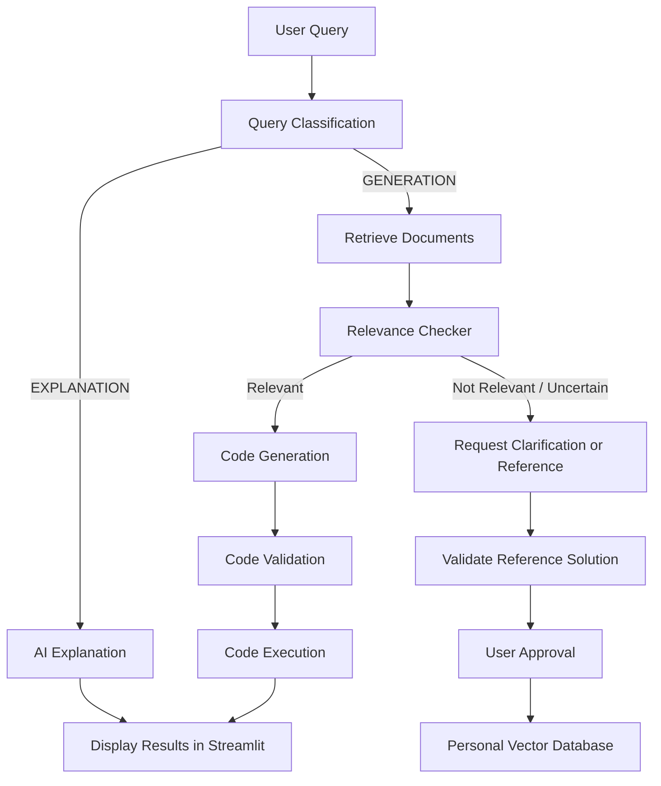

# 🤖 AI Coding Assistant

An intelligent AI-powered coding assistant that helps developers understand programming concepts, generate Python code, retrieve relevant programming examples, and validate and execute generated solutions.

The system combines **LLM-based reasoning, Retrieval-Augmented Generation (RAG), vector databases, and code validation** to provide a structured coding workflow.

## ✨ Features

- **Query Classification:** Classifies user queries into `EXPLANATION` or `GENERATION`.
- **AI Explanations:** Provides answers to programming questions and explains technical concepts.
- **Code Generation:** Generates Python solutions based on user requirements.
- **Retrieval-Augmented Generation (RAG):** Retrieves relevant examples from the HumanEval dataset and stored user solutions.
- **Relevance Checking:** Evaluates whether retrieved documents are relevant to the current coding task.
- **Code Validation:** Checks Python syntax and performs basic validation.
- **Code Execution:** Runs Python code with a configurable timeout.
- **Personal Knowledge Base:** Stores approved solutions for future retrieval.
- **Interactive Streamlit UI:** Provides a user-friendly interface for interacting with the assistant.
- **Reference Solutions:** Allows users to provide solutions when the retrieved context is insufficient.

## 🧠 System Workflow



## 🛠️ Technologies Used

- **Python** — Core programming language
- **Streamlit** — Interactive web interface
- **LangChain** — LLM integration and workflow components
- **OpenRouter API** — Access to supported language models
- **ChromaDB** — Vector storage and similarity search
- **HumanEval Dataset** — Programming problems and examples
- **LLMs** — Query classification, explanations, relevance evaluation, and code generation

## 📂 Project Structure

```text
Ai_Assistant_Code/
│
├── app.py                  # Streamlit application
├── main.py                 # Main workflow orchestration
├── classification.py       # Query classification
├── explanation.py           # Programming explanations
├── dataset.py               # HumanEval vector database
├── relevance_checker.py     # Retrieved context evaluation
├── generation.py             # Code generation
├── code_runner.py            # Python code execution
├── solution_validator.py     # Basic code validation
├── memory_store.py           # Personal solution storage
├── .env                     # API key configuration
├── .gitignore
└── README.md
```

*Note: The structure above is based on the project's current modules. Adjust filenames if your local repository differs.*

## ⚙️ Installation

### 1. Clone the repository

```bash
git clone <YOUR_GITHUB_REPOSITORY_URL>
cd Ai_Assistant_Code
```

### 2. Create a virtual environment

```bash
python -m venv .venv
```

Activate it on Windows:

```powershell
.venv\Scripts\Activate.ps1
```

### 3. Install dependencies

```bash
pip install streamlit langchain-openai langchain-chroma chromadb python-dotenv
```

Install any additional dependencies required by your existing Python modules.

### 4. Configure your API key

Create a `.env` file in the project root:

```env
OPENROUTER_API_KEY=your_openrouter_api_key
```

Replace the placeholder with your own API key.

**Security:** Never upload your `.env` file or expose your API key in source code. Add `.env` and `.venv/` to `.gitignore`.

### 5. Run the application

```bash
streamlit run app.py
```

Streamlit will provide a local URL where you can open the application in your browser.

## 🚀 How to Use

1. Launch the Streamlit application.
2. Enter a programming question or describe a coding task.
3. The classifier determines whether you need an explanation or code generation.
4. For generation requests, the system retrieves potentially relevant programming examples.
5. The relevance checker evaluates the retrieved context.
6. If the context is relevant, the assistant generates a solution.
7. The solution can undergo basic validation and optional execution.
8. If relevant context is unavailable, you can provide a reference solution and choose whether to save it for future retrieval.

## 🔍 Retrieval-Augmented Generation (RAG)

The project uses vector similarity search to retrieve programming examples related to a user's request.

The retrieved documents are evaluated before being passed to the generation model. This helps reduce reliance on irrelevant context and supports reuse of previously approved solutions.

The system maintains two knowledge sources:

- **HumanEval Knowledge Base:** Programming tasks and examples from the HumanEval dataset.
- **Personal Knowledge Base:** User-provided solutions saved for future retrieval.

## 🛡️ Validation and Security

The project includes basic validation and controlled execution features. However:

- Syntax validation does not guarantee that a solution is logically correct.
- Successful execution alone does not prove that a solution satisfies the task.
- Task-specific test cases are needed for stronger correctness verification.
- Executing arbitrary generated code with a subprocess and timeout is **not a secure sandbox**. Do not run untrusted code on sensitive systems.

For production deployment, code execution should be isolated in a properly secured sandbox with resource limits and restricted filesystem and network access.

## 🔮 Future Improvements

- Add automated unit-test generation and task-specific correctness evaluation.
- Introduce secure sandboxed code execution.
- Support additional programming languages.
- Improve retrieval with metadata filtering and reranking.
- Add conversation history and user authentication.
- Display detailed execution and validation reports.
- Add automated evaluation metrics for retrieval and code generation.
- Improve error handling and model fallback strategies.

## 👨‍💻 Author

**Ahmed Badawy**

- GitHub: [@A7medBadwy](https://github.com/A7medBadwy)
- LinkedIn: [Ahmed Badawy](https://www.linkedin.com/in/ahmedbadawy5/)

---

*Built as an AI-powered coding assistant project exploring LLMs, RAG, vector databases, and automated code validation.*
